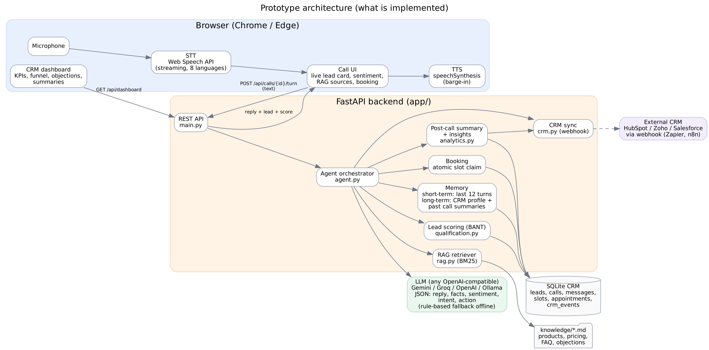

# Autonomous AI Sales Voice Agent: working prototype

A voice agent that talks to sales leads in real time and in their language. It answers questions from company knowledge (RAG), qualifies the lead, handles objections, books an appointment, updates the CRM, and summarises every call with business insights.

The demo business is **SunVolt Solar** (fictional rooftop-solar installer, India).



## Features → code
| Requirement | Implementation |
|---|---|
| Real-time voice (STT + TTS) | Browser streaming speech recognition + speech synthesis, auto-listen, barge-in (`static/app.js`) |
| Contextual memory | Last 12 turns + CRM profile + previous call summaries and upcoming appointment, keyed by phone (`app/agent.py`) |
| Multilingual | English, Hindi, Tamil, Telugu, Kannada, Marathi, Bengali, Spanish; follows the caller if they switch |
| Lead qualification | LLM extracts facts → deterministic BANT score 0–100 with reasons (`app/qualification.py`) |
| Sentiment analysis | Per-turn sentiment + intent, call average, dashboard KPI |
| RAG | BM25 retrieval over `knowledge/*.md`, sources shown live (`app/rag.py`) |
| Appointment booking | Slot calendar, atomic booking, LLM can only pick offered slots (`app/db.py`) |
| CRM integration | Built-in CRM + event webhook to HubSpot/Zoho/Salesforce via Zapier/n8n (`app/crm.py`) |
| Summaries and insights | Post-call AI summary; dashboard with conversion, funnel, objections, languages (`app/analytics.py`) |

## Run it (about 2 minutes)
```bash
python -m venv .venv && source .venv/bin/activate      # Windows: .venv\Scripts\activate
pip install -r requirements.txt
cp .env.example .env        # paste a free Gemini or Groq key into LLM_API_KEY
uvicorn app.main:app --reload
```
Open **http://localhost:8000** in **Chrome or Edge** (they support the voice APIs), allow the microphone, and click **Start call**. The CRM dashboard is at **http://localhost:8000/dashboard**.

- No API key? The app still runs with a rule-based fallback brain (English only, shown in the header) so the workflow can be demoed offline.
- You can also type caller lines in the text box instead of speaking.
- Docker: `docker compose up --build`
- Tests: `pytest -q` (9 tests, including the full end-to-end workflow; runs offline)

## API
| Method | Path | Purpose |
|---|---|---|
| POST | `/api/calls` `{phone, language}` | Start a call (finds or creates the lead, loads memory, returns greeting) |
| POST | `/api/calls/{id}/turn` `{text}` | One caller utterance → reply, lead, score, sentiment, booking |
| POST | `/api/calls/{id}/end` | End the call → AI summary, CRM sync |
| GET | `/api/calls/{id}` | Transcript with per-turn sentiment and intent |
| GET | `/api/dashboard` | KPIs, funnel, objections, leads, appointments, calls, CRM events |
| GET | `/api/slots`, `/health` | Free slots, health/brain mode |

Interactive API docs: http://localhost:8000/docs

## Project layout
```
app/
  main.py           FastAPI routes
  agent.py          orchestration: memory + RAG + LLM + guardrails + actions + summary
  llm.py            OpenAI-compatible client (Gemini/Groq/OpenAI/Ollama) + offline fallback
  rag.py            BM25 knowledge retrieval
  qualification.py  lead scoring (BANT)
  db.py             SQLite CRM: leads, calls, messages, slots, appointments, crm_events
  crm.py            external CRM webhook sync
  analytics.py      business insights
knowledge/          company knowledge base (markdown, one "# Section" per topic)
static/             voice call UI + CRM dashboard (no build step)
docs/               architecture diagrams, scalability/security/cost write-up, demo script
tests/              end-to-end tests
```

## Documentation
- [docs/ARCHITECTURE.md](docs/ARCHITECTURE.md): business problem, technical implementation, scaling to 1,00,000 users, security and compliance, infrastructure and deployment, operating costs, commercial feasibility
- [docs/DEMO_SCRIPT.md](docs/DEMO_SCRIPT.md): step-by-step demo, plus a map of where to make common live-coding changes
- Diagrams: `docs/architecture_prototype.png`, `docs/architecture_production.png` (Graphviz sources `.dot` alongside)

## Prototype limits (production approach in ARCHITECTURE.md)
- Voice runs in the browser, not over a phone line. Production uses Plivo/Exotel media streams with server-side streaming STT/TTS.
- SQLite runs on a single instance. Production uses PostgreSQL + Redis + a queue.
- No login on the dashboard. Production adds SSO + RBAC.
