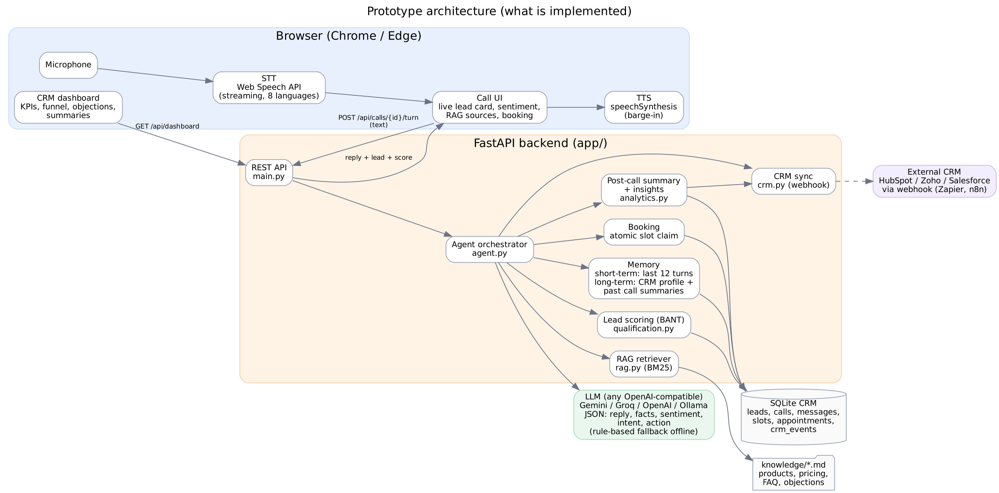
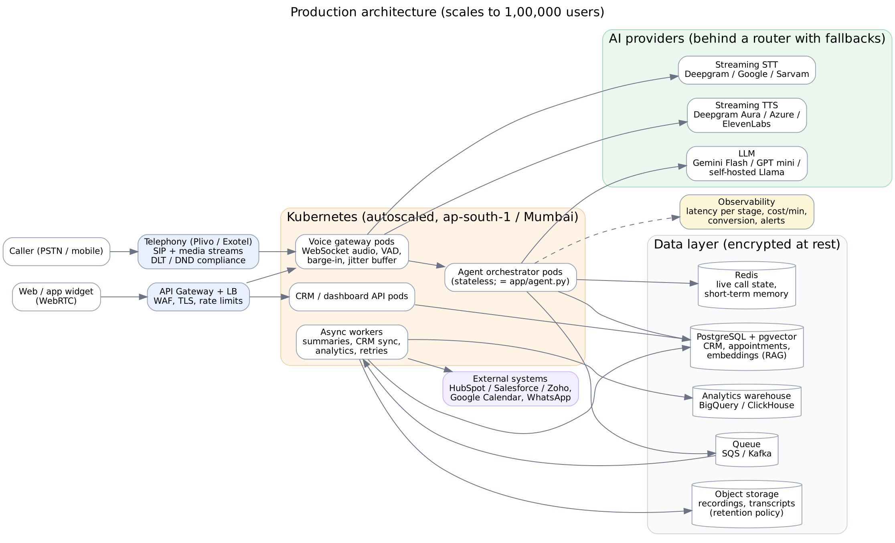

# AI Sales Voice Agent: Architecture, Scale, Security and Cost

## 1. Business problem

Inbound and outbound sales teams in India (solar, real estate, EdTech, insurance, auto, loans) generate thousands of leads a day from ads and forms. Most of them are never called quickly enough:

- **Speed-to-lead is slow.** Leads go cold within minutes, but telecallers call back hours or days later.
- **Telecaller capacity is fixed.** One person handles about 2–3 hours of real talk time a day, works office hours only, and in one or two languages.
- **Qualification is inconsistent.** Each rep asks different questions, CRM fields are filled in late or not at all, and managers can't see *why* deals are lost.
- **Expensive reps spend time on unqualified leads.** Field engineers and senior reps visit leads that were never going to buy.

**The solution** is an AI voice agent that calls or answers every lead instantly, 24x7, in the lead's language. It answers questions from approved company knowledge, qualifies the lead with a consistent scorecard, handles objections, books the next step (here, a free site survey), writes everything to the CRM and summarises each call for managers.

The prototype uses a fictional rooftop-solar company, **SunVolt Solar**. Only the knowledge base and the qualification rules are domain specific, so another business needs only those two parts swapped.

---

## 2. Requirement coverage

| Requirement | Status in prototype | Where |
|---|---|---|
| Real-time voice (STT + TTS) | ✅ Browser streaming STT (Web Speech API) + speechSynthesis TTS, auto-listen loop, barge-in | `static/app.js` |
| Contextual memory | ✅ Short-term: last 12 turns. Long-term: CRM profile + summaries of previous calls, keyed by caller phone | `agent.py`, `db.past_call_summaries` |
| Multilingual | ✅ 8 languages (English, Hindi, Tamil, Telugu, Kannada, Marathi, Bengali, Spanish). The LLM follows the caller if they switch mid-call | `agent.LANGUAGES`, system prompt |
| Lead qualification | ✅ LLM extracts facts; **deterministic BANT score in code** (0–100, with reasons), cold/warm/hot status | `qualification.py` |
| Sentiment analysis | ✅ Per-turn sentiment + intent, call-level average, dashboard KPI | `agent.py`, `analytics.py` |
| RAG knowledge retrieval | ✅ BM25 over markdown knowledge sections, top-3 sections injected per turn, sources shown live in the UI | `rag.py`, `knowledge/` |
| Appointment booking | ✅ Slot calendar, LLM may only choose an offered slot, atomic claim (no double booking) | `db.book_slot` |
| CRM integration | ✅ Built-in CRM (leads, calls, appointments) + event webhook to external CRMs, with a delivery log | `db.py`, `crm.py` |
| Call summarisation | ✅ Post-call LLM summary: key points, objections, next steps, outcome | `agent.end_call` |
| Business insights | ✅ Dashboard: conversion, avg score, sentiment, funnel, top objections, outcomes, language mix | `analytics.py`, `/dashboard` |

**End-to-end workflow shown:** lead calls → greeting → questions answered from RAG → qualification → objection handled → site survey booked → call ended → AI summary → CRM updated + webhook events → dashboard insights. On the next call from the same number, the agent greets the caller by name and remembers the earlier call.

---

## 3. Technical implementation (prototype)

### Per-turn pipeline (`agent.handle_turn`)
1. **STT** in the browser produces the caller's text (streaming interim results are shown live).
2. **Memory.** The last 12 messages of this call, the CRM profile, and summaries of up to 3 previous calls.
3. **RAG.** BM25 search over knowledge sections using the caller's text plus the agent's last question. The top 3 sections go into the prompt.
4. **LLM call (JSON mode).** One call returns `reply`, `lead_updates`, `sentiment`, `intent` and `action` (`none` / `book_appointment` / `end_call`). A single structured call keeps latency low and works with any OpenAI-compatible provider. It does not depend on provider-specific tool-calling quirks.
5. **Guardrails in code.** The LLM never writes to the database directly.
   - `clean_updates` validates every extracted field (types, enums, ranges).
   - The lead score is computed deterministically from those fields, so it is explainable and auditable.
   - A booking succeeds only if `slot_id` is one of the slots that were offered, and the slot is claimed atomically (`UPDATE … WHERE is_booked=0`).
6. **CRM events** (`lead_qualified`, `appointment_booked`, `call_summarised`) are logged and pushed to `CRM_WEBHOOK_URL`.
7. **TTS** speaks the reply. The mic re-opens automatically, and pressing the mic interrupts the agent (barge-in).

### Design decisions
- **Provider-agnostic LLM.** OpenAI, Gemini, Groq or a local Ollama model is chosen with three environment variables. A rule-based fallback keeps the demo and tests working with no key or network; the UI shows which one is active.
- **Scoring in code, not in the LLM.** Sales managers can read, tune and trust the numbers. The LLM is used for language, not for business rules.
- **BM25 for RAG in the prototype.** No embedding service is needed, it is fully explainable, and it works well for short FAQ-style knowledge. The `search()` interface is the swap point for embeddings in production.
- **Half-duplex browser voice.** The mic is paused while the agent speaks so it can't transcribe itself. Production uses server-side VAD with echo cancellation for full duplex.

### Remaining features: production approach
| Area | Prototype | Production |
|---|---|---|
| Phone calls | Browser mic | Plivo/Exotel number → media stream WebSocket → voice gateway |
| STT/TTS | Browser engines | Streaming Deepgram / Google / Sarvam (Indic) STT; Deepgram Aura / Azure / ElevenLabs TTS; streamed LLM tokens → TTS sentence by sentence |
| Memory store | SQLite | Redis (live call state) + PostgreSQL (CRM, long-term memory) |
| RAG | BM25 over markdown | Hybrid BM25 + embeddings in pgvector, admin upload of PDFs, versioned knowledge |
| Calendar | Internal slots | Google/Microsoft calendar sync, rep/territory routing, SMS/WhatsApp confirmation |
| CRM | Webhook | Native HubSpot/Salesforce/Zoho connectors, two-way sync, idempotent retries via queue |
| Outbound dialing | – | Campaign scheduler with DND scrubbing, retries, calling-hour windows |

---

## 4. Scalability strategy: 1,00,000 users

### Load assumptions
"1,00,000 users" is modelled as **1 lakh leads per month** handled by the agent, with the dashboard used by client sales teams.

| Metric | Value |
|---|---|
| Leads / month | 1,00,000 |
| Calls per lead (incl. follow-ups) | 1.5 → **1,50,000 calls / month** |
| Avg call length | 4 min → **6,00,000 voice minutes / month** |
| Calling window | 10 h/day × 26 days = 260 h |
| Average concurrency | 1,50,000 / 260 h ≈ 577 calls/h × 4 min ≈ **~40 concurrent calls** |
| Peak concurrency (5× burst after an ad campaign) | **~200 concurrent calls** |
| Design target with headroom | **1,000 concurrent calls** |
| LLM load at design target | 1 turn / 15 s per call → ~67 LLM requests/s, ~4M tokens/min |

### How each layer scales
- **Stateless compute.** Orchestrator and API pods keep no call state (call state lives in Redis), so any pod can serve any turn. The Kubernetes HPA scales on CPU and active WebSocket count.
  - Voice gateway: ~100 concurrent audio streams per 2-vCPU pod → **10 pods** at 1,000 concurrent.
  - Orchestrator: async I/O, ~200 concurrent turns per pod → **5 pods** at 1,000 concurrent.
- **AI providers are the real bottleneck,** not our compute. We use:
  - enterprise quotas plus a provider router (primary + fallback LLM/STT/TTS) with circuit breakers;
  - prompt caching of the static system prompt;
  - a self-hosted open model (e.g. Llama on GPU) as a cost and quota hedge above about 1M minutes/month.
- **Database.**
  - Managed PostgreSQL with a primary plus read replicas (dashboards read from replicas) and PgBouncer pooling.
  - At this volume the data is small: about 1.5 lakh call rows and about 3M message rows per month. Monthly partitions on `messages`/`calls`, with old transcripts archived to object storage.
- **Async work off the hot path.** Summaries, CRM sync, analytics and retries go through a queue (SQS/Kafka), so a slow CRM never adds call latency.
- **Analytics** stream into a warehouse (BigQuery/ClickHouse), so heavy reports never hit the OLTP database.
- **Latency budget** (voice-to-voice, under 1.2 s): STT endpointing ~300 ms + LLM first token ~400 ms (streamed) + TTS first audio ~200 ms + network ~150 ms. Deploying in **ap-south-1 (Mumbai)** keeps the network short for Indian callers.
- **Multi-tenancy.** A `tenant_id` on every table with row-level security, plus per-tenant knowledge bases, scoring rules, voices and rate limits.
- **Load testing.** A synthetic caller (TTS → our pipeline) runs 1,000 concurrent scripted calls before each release. We track p95 turn latency, error rate and cost per minute.

---

## 5. Data security and compliance

**Implemented in the prototype**
- Pydantic validation and length limits on every input; parameterised SQL everywhere.
- LLM output is treated as untrusted: field validation, enum checks, and a booking allowed only from the offered slot list.
- Prompt-injection guard in the system prompt; the LLM has no direct database or tool access.
- HTML escaping of all transcript and CRM values in the UI (stops XSS from spoken or injected text).
- Secrets only in `.env` (git-ignored).

**Production controls**
- **India regulation**
  - **DPDP Act 2023:** explicit consent, purpose limitation, data-principal rights (access, erasure), breach reporting.
  - **TRAI TCCCPR:** DND/NCPR scrubbing before outbound calls, DLT-registered headers and templates, calling-hour windows, honouring opt-outs. Our "not interested / don't call" intent writes to a suppression list.
- **Disclosure.** The agent says it is an AI assistant, and that the call is recorded, at the start of each call.
- **Encryption.** TLS 1.2+ in transit; AES-256 at rest (RDS/S3 KMS); field-level encryption for phone and email; India data residency.
- **Access.** SSO + RBAC (agent admin, sales manager, rep); tenant isolation via row-level security; audit log of every CRM read/write and export.
- **AI providers.** Enterprise contracts with zero data retention and no training on our data. PII is redacted from logs and analytics.
- **Retention.** Recordings and transcripts are kept for N days per tenant policy, then deleted automatically. Summaries are kept for the life of the CRM record.
- **AppSec.** WAF and rate limiting at the gateway; secrets in AWS Secrets Manager or Vault; dependency and container scanning in CI; yearly penetration test.

---

## 6. Infrastructure and deployment

- **Now (prototype):** `docker compose up` gives a single container with SQLite on a volume. It runs on a laptop, a ₹500/month VM, Render or Railway.
- **Production:**
  - Terraform → AWS ap-south-1 (EKS, RDS PostgreSQL, ElastiCache Redis, SQS, S3, CloudWatch/Grafana).
  - GitHub Actions: test → build image → scan → push to ECR → Helm deploy to staging → canary or blue-green to production.
  - Feature flags per tenant to roll out new prompts and models gradually.
  - Prompts and knowledge are versioned. Every release runs an evaluation set of recorded conversations (qualification accuracy, booking success, hallucination checks).
- **Observability:**
  - Per-stage latency (STT, LLM, TTS) and errors by provider.
  - Cost per minute and per tenant.
  - Business metrics: conversion, booking rate, sentiment. Alerts when any of these drift.

---

## 7. Operational costs

Exchange rate assumed: **₹88 = $1**. Provider list prices as of November 2026, pay-as-you-go, before volume discounts.

| Component (per call minute) | Basis | ₹ / min |
|---|---|---|
| Telephony (Plivo India outbound) | ~₹0.40/min | 0.40 |
| Streaming STT (Deepgram Nova-3 multilingual) | ~$0.0092/min | 0.81 |
| TTS (Deepgram Aura-2) | $0.030 per 1k chars × ~400 chars/min of agent speech | 1.06 |
| LLM (Flash-class, ~$1.50 / $7.50 per 1M tokens in/out) | ~4 turns/min × (2,500 in + 100 out) tokens | 1.58 |
| Post-call summary (LLM) | ~₹0.60 per call ÷ 4 min | 0.15 |
| Cloud infra (compute, DB, storage, monitoring) | ~₹1.5 lakh/month ÷ 6 lakh min | 0.25 |
| **Total** | | **≈ ₹4.25 / min (≈ ₹17 per 4-min call)** |

Optimisations: prompt caching (the static prompt is about 60% of input tokens), cheaper or self-hosted models for summaries, and volume telephony/STT pricing. Together these can bring the cost toward **₹2.5–3 / min**.

### Monthly at 1 lakh leads (6 lakh minutes)
| | AI agent | Human telecallers |
|---|---|---|
| Capacity needed | Elastic | ~160 telecallers (≈3,750 talk-min each per month) |
| Monthly cost | **≈ ₹25.5 lakh** all-in | ≈ ₹56 lakh salaries (₹35k loaded) + telephony + team leads |
| Cost per qualified lead | ~₹25–40 | ~₹60–100 |
| Availability / speed-to-lead | 24x7, seconds | Office hours, hours |
| Languages | 8+ | 1–2 per rep |

### Commercial feasibility
- **Pricing model:** ₹8–10 per connected minute, or ₹1,500–4,000/month platform fee plus usage, or pay-per-booked-appointment for performance-oriented clients. At ₹8/min against ₹4.25/min cost, gross margin is about **47%**, rising toward 65% as optimisations land.
- **Customer ROI (solar example):** an extra 1% of leads converting to a ₹2.9 lakh installation is worth far more than the call cost. Faster speed-to-lead alone typically lifts contact rates materially.
- **Go-to-market:** start with one vertical (rooftop solar / real estate) where a site visit or demo is the clear conversion event, then templatise the knowledge base and scorecard for other verticals.
- **Risks and mitigations:**
  - AI-call regulation → compliance features built in.
  - Caller acceptance → AI disclosure plus warm hand-off to a human rep on request or on negative sentiment.
  - Provider price changes → multi-provider router.
